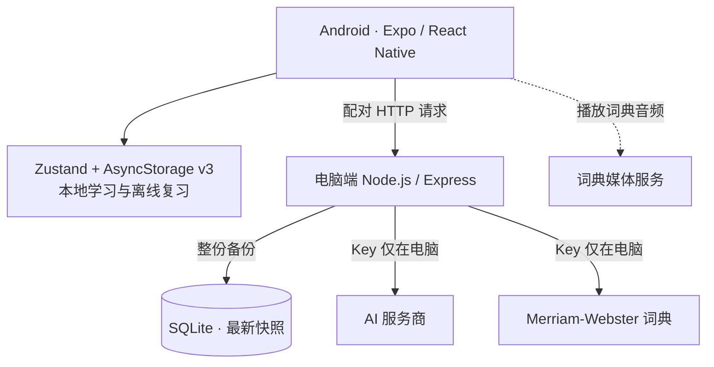
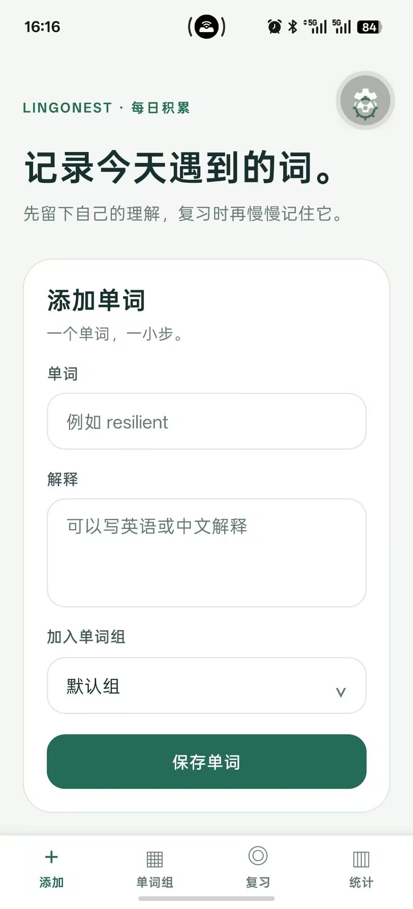
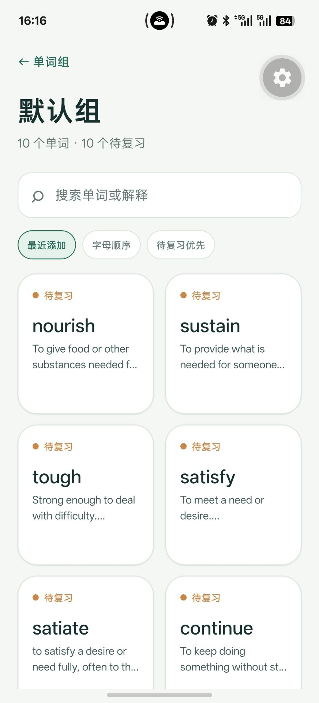
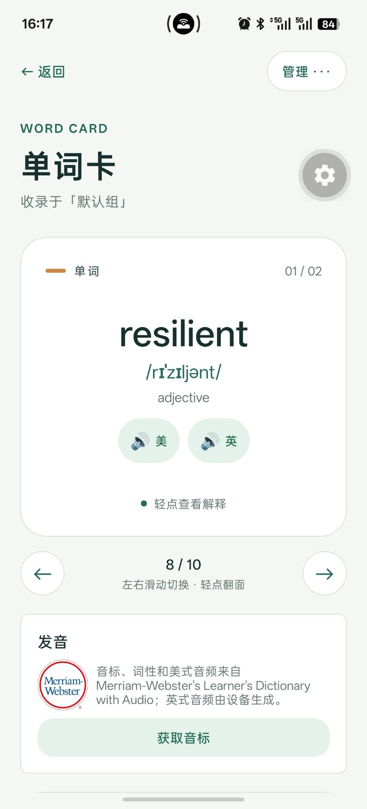
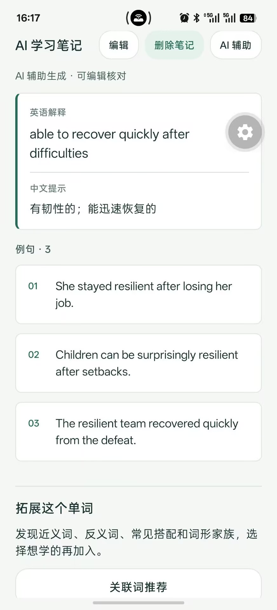
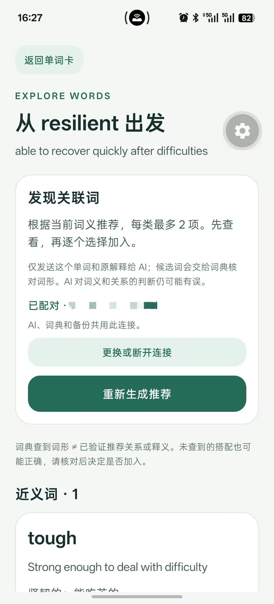
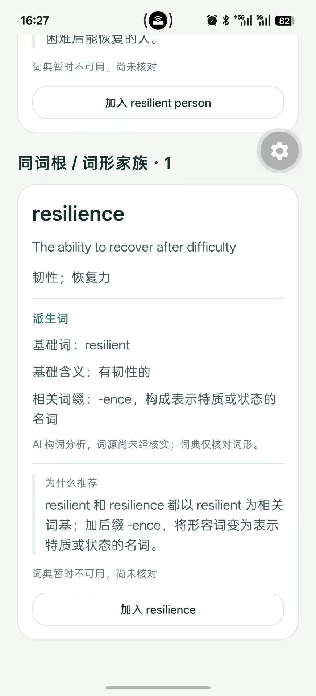
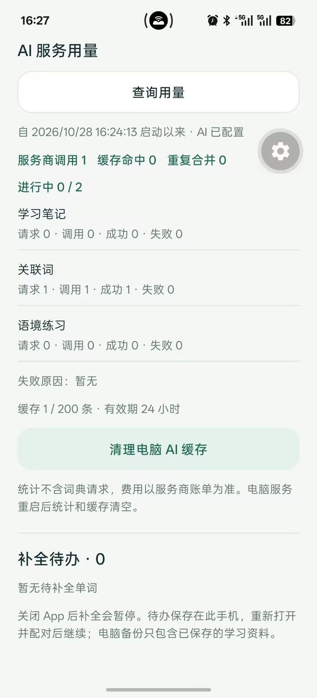
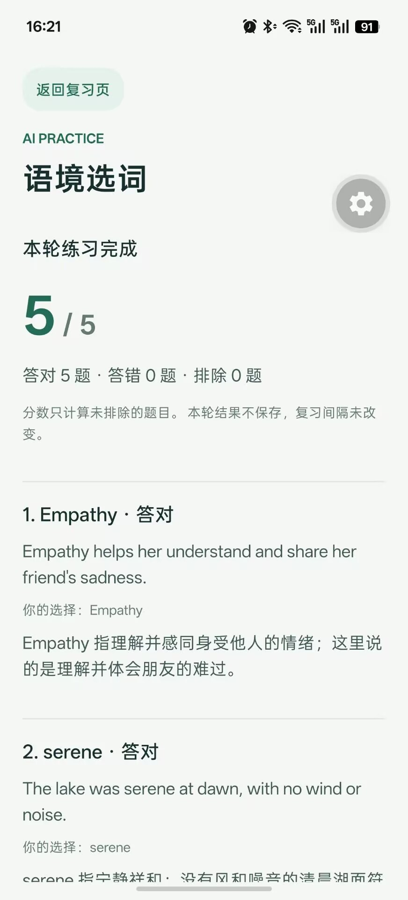
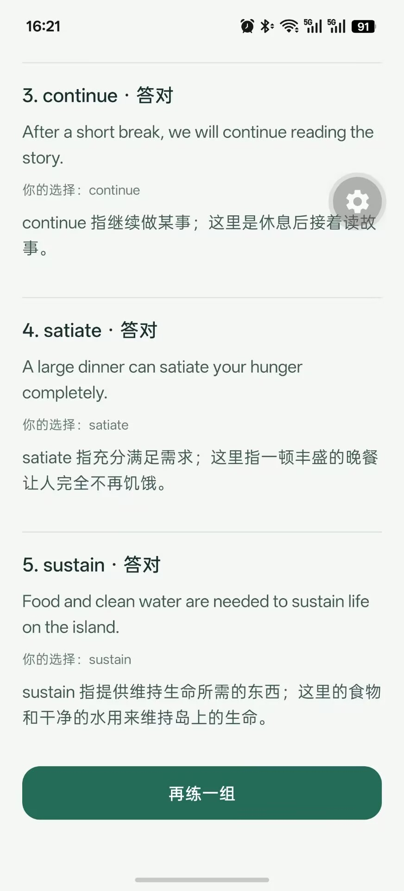

# LingoNest

LingoNest（暂定名）是一款 Android 优先的英语词汇学习应用，帮助英语基础较弱的用户快速记录单词、写下英语或中文解释、整理分组，并在合适的时间复习。

**阶段 3、4.0～4.5 已获用户测试确认；4.6 文档和截图已整理，5.0a 已保存代码基线。** 下一步为独立 Android 测试安装包，设备与应用版本信息继续补录。当前是本地优先的 Android 应用，配合电脑端服务提供备份、AI 和词典能力。项目状态以 [PROJECT_STATUS.md](PROJECT_STATUS.md) 为准。

## 当前核心流程

```text
添加单词 → 选择分组 → 在两列卡片库中搜索/浏览
                         ↓
             左右滑动同组卡片 · 轻点翻面
                         ↓
             到期后进入独立复习会话
                         ↓
               翻面 → 反馈 → 安排下次复习
```

MVP 2.0 的固定间隔是：记住了后 1、3、7、14、30 天逐步延长；再来一次为 10 分钟后；有点模糊为 1 天后并降低阶段。这个规则先追求清楚和可验证，后续再根据真实使用决定是否升级算法。

单词卡详情页把修改、移动、删除收在右上角“管理”中。卡片向左滑看同组下一张、向右滑看上一张；也可以使用卡片下方的箭头。切换后默认显示正面，浏览不会增加复习记录。

扩展词汇：单词卡 → 关联词推荐 → 查看近义词、反义词、搭配和词形家族及推荐理由 → 修改解释、选择分组 → 逐项确认加入。每次最多 8 项，全库查重；确认后的新卡进入普通复习与本地保存，取消不导入。

自动补全：添加页右上角设置 → 分别开启词典资料和 AI 笔记 → 连接电脑 → 添加新词。确认加入的关联词也遵循开关；旧词可在详情页选择“补全缺失资料”。设置和未完成任务保存在此手机，后台或关闭 App 会暂停，重开并配对后继续；失败可重试、待办可取消，不覆盖已有资料。开始恢复备份会取消旧待办，恢复的词不会整库自动发送。

## 技术概览

| 层 | 实际技术 | 在项目中的职责 |
|---|---|---|
| 移动端 | TypeScript 6、React 19、React Native 0.88、Expo SDK 58 | Android 页面、表单、列表和卡片动画 |
| 页面与状态 | Expo Router、Zustand | 页面导航与跨页面学习状态 |
| 本地保存 | AsyncStorage 2、v3 快照协议 | 保存单词、分组、AI 笔记和复习状态；兼容旧数据 |
| 发音 | Expo Audio、Expo Speech | 美式词典音频播放和设备 `en-GB` 朗读 |
| 电脑后端 | Node.js 24+、TypeScript、Express 5 | 局域网配对、输入校验、AI/词典请求和安全错误 |
| 电脑备份 | SQLite、better-sqlite3 | 最新完整备份、事务内版本检查、数据库身份校验 |
| 外部服务 | 兼容 Chat Completions 的 AI API、Merriam-Webster Learner's Dictionary API | 生成学习草稿，查询 IPA、词性和美式音频 |
| 验证 | Node.js 内置测试工具、TypeScript 检查、Expo Android 导出 | 验证迁移、备份、权限和 AI 请求边界 |

AI 笔记包含简短英语解释、中文提示和三个例句，可保存、离线编辑或删除。手动生成先预览；自动补全默认关闭，用户开启后才在新词保存后补充，原解释不覆盖。练习由 AI 生成语境草稿，选项和判分由手机控制，结果暂不改变复习。

分析/推荐成功结果在电脑内存缓存 24 小时，最多 200 条；同输入的在途生成合并，同时最多两个不同 AI 任务，失败不缓存、不自动重试。设置页可查看聚合用量并清缓存；重启清空，统计不是费用账单。

当前不包含账号、自动云同步、虚拟角色或商城。Supabase / PostgreSQL 仅属于保留的历史方案，不计入已实现技术栈。本项目由开发者与 AI 协作完成，关键取舍、测试和实际问题保留在项目文档中。

## 架构一览



SQLite 只保存最新完整备份，没有单独的词汇关系表。关联词由 AI 推荐、词典核对候选词形，用户确认后作为普通卡片写入手机；词形命中不证明关系或词源正确。更多细节见[完整架构和请求流程](docs/architecture/ARCHITECTURE.md)。

AI 和词典 Key 只配置在电脑端。AI 请求会把选定单词和解释发送给外部服务商；局域网配对 HTTP 未加密，仅用于可信私人网络。电脑服务不可用时仍可本地学习；首次 AI/词典查询和网络音频需要联网。词典使用及公开发布前的许可待确认项见[数据来源与授权边界](docs/reference/DICTIONARY_DATA.md)。

## Android 实机截图

以下图片由用户于 2026-10-28 和 2026-10-29 从 Android App 提供。它们展示当前实现，不代表每个画面都由 4.6 本轮新测；练习结果由两张连续截图呈现，复习完成图据用户说明是在电脑后端停止期间拍摄。

| 添加单词 | 单词组 | 单词卡与发音 |
|---|---|---|
|  |  |  |

| AI 学习笔记 | 关联词推荐 | 词形家族说明 |
|---|---|---|
|  |  |  |

AI 服务用量：

| 语境练习完成页 | 语境练习结果续页 | 本地复习完成页 |
|---|---|---|
|  |  |  |

练习画面为同一轮结果；离线复习截图的后端停止情境依据用户说明，单张图本身无法独立证明服务器状态。全部文件、来源和边界见[截图清单](docs/showcase/screenshots/README.md)。

## 仓库结构

```text
LingoNest/
├── mobile/       Android App：页面、组件、本地状态、接口和测试
├── server/       电脑端 Express 服务、SQLite 备份和接口测试
├── docs/         产品、架构、决策、学习、测试和展示资料
└── supabase/     早期云端方案迁移文件，当前不使用
```

## 本地运行

需要 Node.js 24+ 和支持 SDK 58 的 Android Expo Go。在仓库根目录打开终端：

```powershell
cd mobile
npm.cmd ci
npx.cmd expo start
```

用 Android 手机上的 Expo Go 扫描二维码并打开项目。修改代码后可在 Expo Go 重新加载；遇到缓存问题再使用 `npx.cmd expo start -c`。
升级 SDK 后应先确认现有单词仍可读取；不要为解决版本不兼容而卸载 Expo Go 或清除其应用数据。

电脑后端在另一个终端独立运行，安装、`.env` 和局域网配对步骤见 [server/README.md](server/README.md)。不配置 AI/词典也能使用本地学习功能。电脑地址可记住；重开 App 或重启后端后，需要重新配对。不要提交真实 `.env`、数据库或配对码。

## 验收

2026-10-30 的 5.0a 复验：**后端 44/44、移动端 87/87 测试通过，两端类型检查及 Android 导出通过。** 提交范围和复现命令见[阶段 4 代码基线](docs/releases/PHASE_4_BASELINE.md)，历史结果和实际边界见[阶段 4 验证结果](docs/testing/PHASE_4_RESULTS.md)；模拟服务商测试不证明真实 AI 的语义质量，资源导出也不等于独立 APK 发布。

分别在安装完依赖的 `mobile/`、`server/` 目录执行 `npm.cmd test` 和 `npm.cmd run typecheck`。在 `mobile/` 可另运行 `npx.cmd expo export --platform android` 检查打包。

手机基础验收见 [MVP 测试计划](docs/testing/MVP_TEST_PLAN.md)，AI 各阶段清单保存在 [docs/testing/](docs/testing/)。求职演示可按[演示稿](docs/showcase/DEMO_GUIDE.md)展示添加、AI 预览保存、练习和电脑后端停止期间的本地复习；截图已补齐，设备与应用版本信息仍待记录。

## 项目文档阅读顺序

1. [PROJECT_CONSTITUTION.md](PROJECT_CONSTITUTION.md)：最高层治理原则。
2. [PROJECT_STATUS.md](PROJECT_STATUS.md)：当前状态、未验收项目和接续规则。
3. [PROJECT_ROADMAP.md](PROJECT_ROADMAP.md)：阶段路线和完成标准。
4. [当前架构与 AI 请求流程](docs/architecture/ARCHITECTURE.md)：组件关系、提示词、校验与安全边界。
5. [数据与迁移说明](docs/architecture/DATA_MIGRATIONS.md)：v2→v3、备份和恢复机制。
6. [词典数据来源](docs/reference/DICTIONARY_DATA.md)：发音来源、授权限制与待确认项。
7. [阶段 4 验证结果](docs/testing/PHASE_4_RESULTS.md)、[演示稿](docs/showcase/DEMO_GUIDE.md)：测试证据与展示顺序。
8. [产品范围](docs/product/MVP.md)、[技术决策](docs/decisions/)、[学习与问题记录](docs/learning/)：需求、取舍和开发过程。

## 后续方向

下一步为 5.0b 独立 Android 测试包，随后验证旧数据恢复、离线本地学习和真实日常体验；游戏化根据试用结果推进。AI 和电脑备份仍需连接本地后端。多用户部署、账号与自动同步需要另行设计，详见[路线图](PROJECT_ROADMAP.md)。
