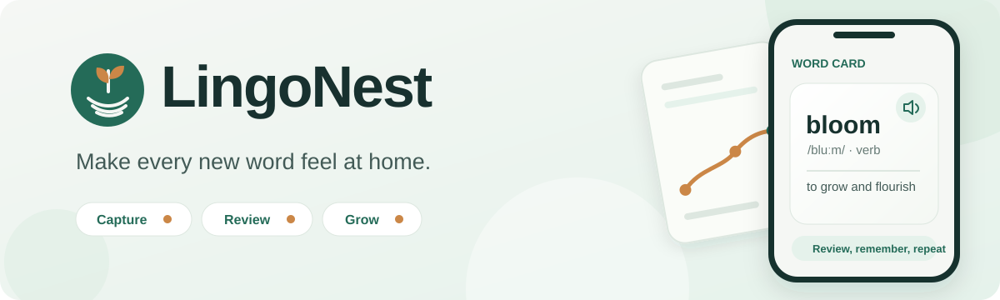
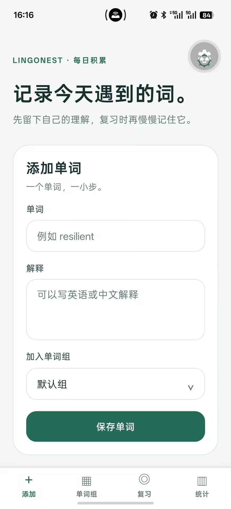
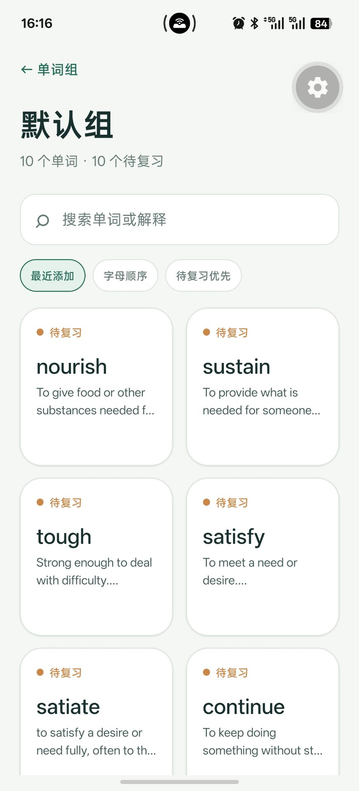
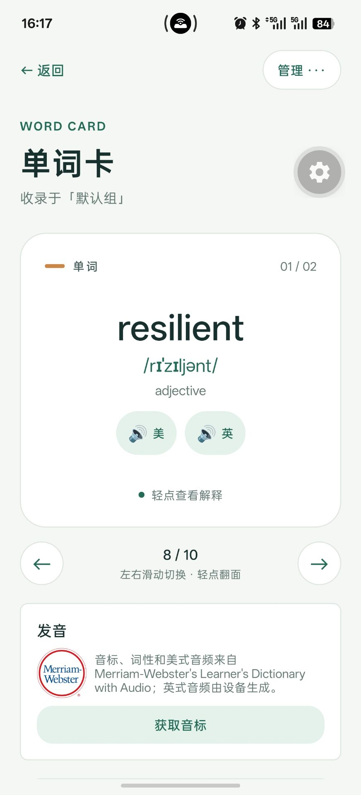
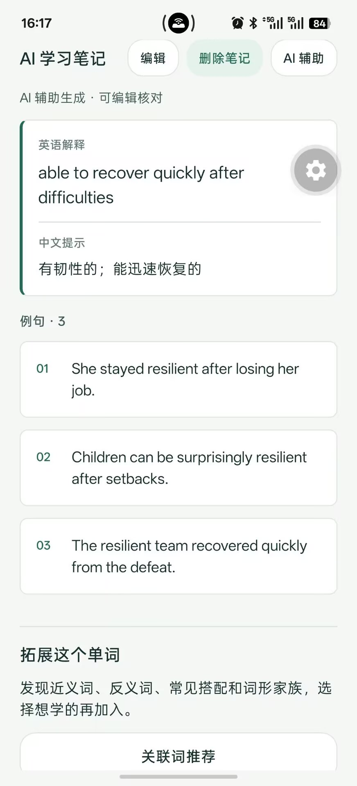
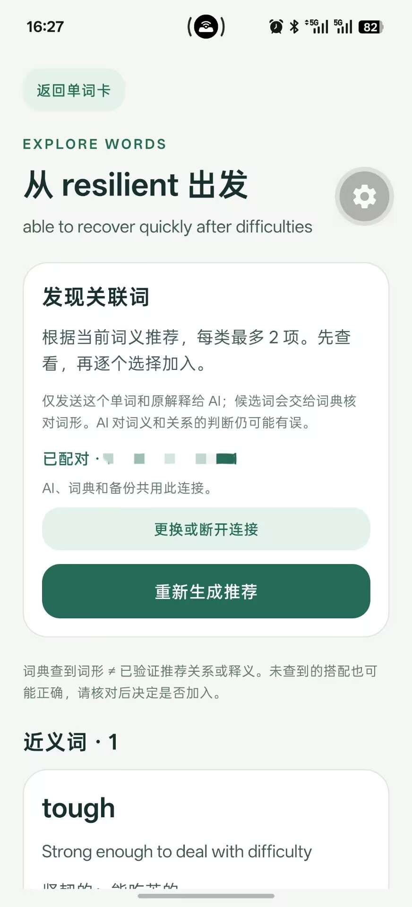
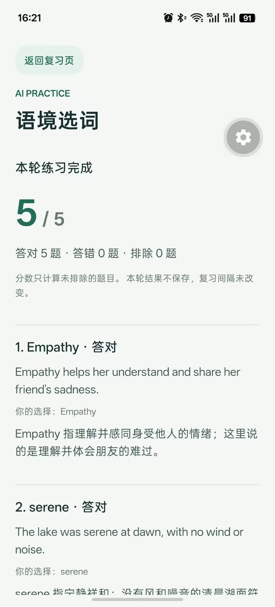
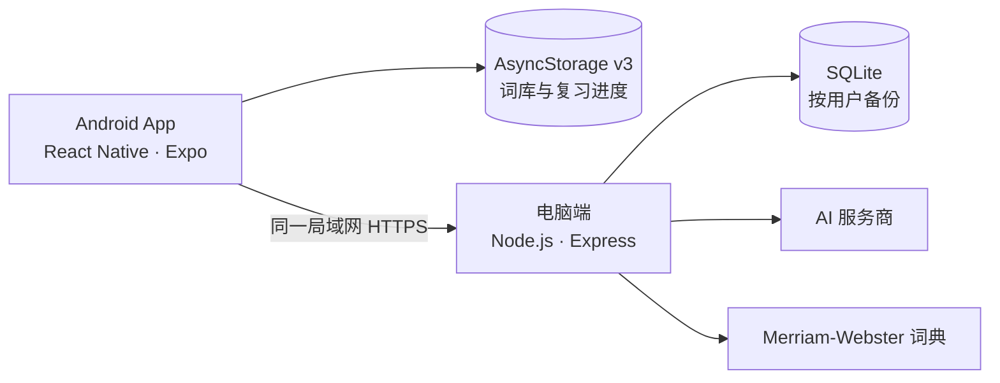

# LingoNest



**让随手记下的单词，变成真正记住的词汇。** LingoNest 是一款 Android 优先、本地优先的英语词汇学习应用：记录单词、整理分组、翻看卡片、按记忆情况复习；需要时再用 AI 和词典补充理解与练习。

> **项目状态**：当前为 Android 测试版本，核心学习流程可离线使用。局域网账号与按人备份已实现，双账号真机完整回归仍在进行；项目尚未公开上线。最新进度见 [PROJECT_STATUS.md](PROJECT_STATUS.md)。

## 功能概览

| 学习环节 | 已实现的体验 |
| --- | --- |
| 记录与整理 | 自定义单词及中英文解释、单词组、跨组搜索、卡片翻面和同组切换。 |
| 间隔复习 | 独立于卡片浏览的复习会话；根据「再来一次 / 有点模糊 / 记住了」安排下一次复习。 |
| AI 辅助 | 可编辑的英文解释、中文提示与三个例句；关联词推荐和语境练习。生成内容先预览，由用户决定是否保存或加入词库。 |
| 词典与发音 | 词典查询音标、词性和美式音频；英式朗读使用设备语音。 |
| 数据保护 | 单词与复习进度保存在手机；可通过同一局域网的电脑服务手动备份与恢复。账号模式支持按用户隔离资料。 |

电脑服务、AI 或词典不可用时，已保存的词库和本地复习仍可使用。当前**没有自动同步、虚拟角色或商城**；这些想法不计入已实现功能。

## Android 实机画面

| 添加单词 | 单词组与搜索 | 单词卡与发音 |
| :---: | :---: | :---: |
|  |  |  |

| AI 学习笔记 | 关联词推荐 | 练习结果 |
| :---: | :---: | :---: |
|  |  |  |

这些是已记录的 Android 画面；截图日期、来源和展示边界见 [截图清单](docs/showcase/screenshots/README.md)。更多演示步骤见 [DEMO_GUIDE.md](docs/showcase/DEMO_GUIDE.md)。

## 技术方案



| 部分 | 实际使用的技术 | 主要职责 |
| --- | --- | --- |
| Android | TypeScript、React Native、Expo SDK 58、Expo Router、Zustand | 页面、导航、状态与卡片交互。 |
| 手机数据 | AsyncStorage v3 快照、SecureStore | 本地词库与复习进度、旧数据迁移；账号会话存入设备安全存储。 |
| 电脑服务 | Node.js、TypeScript、Express、SQLite | 局域网 HTTPS、账号、备份及 AI/词典 API 代理。 |
| 外部能力 | AI API、Merriam-Webster Learner's Dictionary API、Expo Audio / Speech | 学习内容草稿、音标与发音。 |

AI 和词典密钥只配置在电脑端，不进入手机应用或 Git。AI 负责生成草稿，应用负责校验返回格式、控制保存与练习判分；词典核对候选词形，不把 AI 生成的词义关系当作已证实的词源。详见 [架构与请求流程](docs/architecture/ARCHITECTURE.md) 和 [词典数据来源](docs/reference/DICTIONARY_DATA.md)。

## 本地运行

需要 Node.js 24+。在 Windows PowerShell 中启动移动端开发预览：

```powershell
cd mobile
npm.cmd ci
npx.cmd expo start
```

Android 手机可用兼容 SDK 58 的 Expo Go 打开开发预览。**局域网 HTTPS 与账号模式需要包含项目证书配置的 Android 测试包**，不能仅用 Expo Go 代替真机验收。电脑服务的安装、环境变量及启动方式见 [server/README.md](server/README.md)；不启动电脑服务也可以体验本地记词和复习。

[查看 Android 0.5.6 测试包构建记录](https://expo.dev/accounts/lenxifan11/projects/lingonest/builds/a497e69c-8e71-46d0-a152-6080c2a834e0)。这是内部测试构建，不是 Play 商店发布版本；构建产物的下载期限由 EAS 控制。

## 验证与项目记录

在 `mobile/` 和 `server/` 目录分别执行 `npm.cmd test`、`npm.cmd run typecheck`。截至 2026-11-05，移动端 **107 项**、电脑端 **47 项**自动测试通过；这些检查不代替账号模式的双机真机回归。具体清单见 [5.1c 测试计划](docs/testing/PHASE_5_1C_TEST_PLAN.md)。

- [项目状态](PROJECT_STATUS.md) · 当前完成情况和待验证事项
- [项目路线图](PROJECT_ROADMAP.md) · 阶段目标与后续方向
- [技术决策](docs/decisions/) · 为什么采用这些方案
- [数据迁移](docs/architecture/DATA_MIGRATIONS.md) · 本地快照和备份兼容
- [项目宪法](PROJECT_CONSTITUTION.md) · 产品、工程与 AI 协作原则

LingoNest 由开发者与 AI 协作完成，文档保留了产品取舍、实现过程、测试和遇到的问题。
