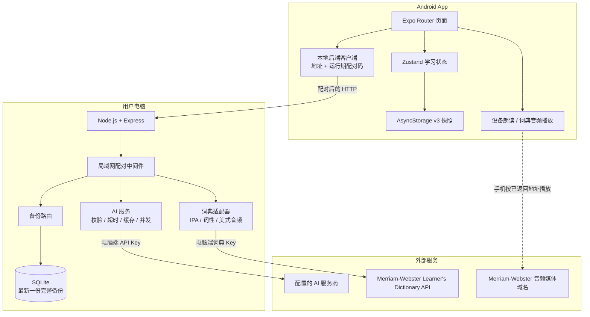
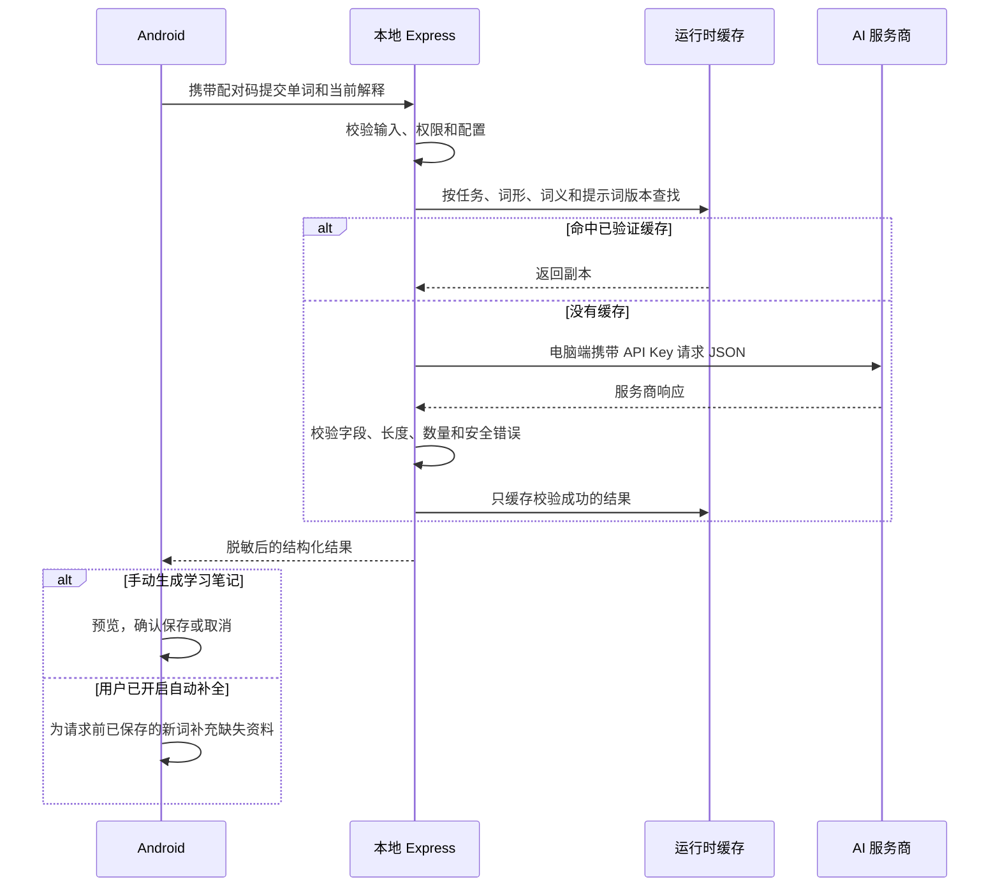

# LingoNest 当前架构

最后更新：2026-10-29

适用范围：阶段 4.6 收口。本文描述工作区当前已经实现的本地学习闭环，不描述尚未开发的账号、云同步或游戏化系统。

## 1. 实际组件关系

SQLite 保存最新一份经过校验的 v2/v3 完整备份和版本元数据，没有独立的“词汇关系表”。手机读取旧备份时转换为 v3。关联词在手机推荐页面临时展示，电脑可能缓存生成结果；用户确认后才作为普通单词卡写入手机，之后随完整快照备份。

## 2. AI 请求流程

上图描述学习笔记生成路径。关联词生成复用相同的 AI 缓存机制，但每次仍会核对候选词形，加入单词库始终需要逐项确认。练习只合并相同的在途请求，完成后不缓存题目；手机生成选项并判分，结果不写入学习快照。

手机不直接访问 AI 服务商，也不接收 API Key。手动保存依赖本次确认；自动保存依赖用户提前开启设置，默认关闭，不覆盖原解释或已有资料。

### 提示词如何变成学习笔记

1. 后端在 `server/src/ai.ts` 中准备系统提示词，要求简短英语解释、中文提示和恰好三个不同语境的例句；例句围绕用户已有解释所指定的词义。
2. 单词和已有解释以数据形式放入请求，提示模型不要把它们当成指令。后端携带模型名称、`temperature: 0.2` 和 `response_format: { type: 'json_object' }` 调用服务商。
3. 返回后再次解析和校验，只接受 `definition`、`chineseHint`、`examples` 三个字段，并检查类型、长度及三个例句是否重复；格式不符合就返回安全错误。
4. 成功结果才允许缓存和预览。格式校验能排除损坏数据，不能证明词义、语法或词源一定正确，用户仍可修改或删除。

这是向现有模型发送提示词的接口调用，没有训练自己的模型。关联词和练习分别使用独立提示词及返回格式校验。AI 等待上限为后端 90 秒、手机 120 秒；同输入合并、最多两个不同任务并发，不自动重试。缓存策略见 [ADR 0013](../decisions/0013-ai-runtime-cache-and-usage.md)。

## 3. 组件职责和边界

| 组件 | 当前职责 | 当前不负责 |
|---|---|---|
| Expo / React Native | Android 页面、导航、动画、输入、离线学习 | 账号、服务端密钥、AI 业务规则的最终校验 |
| Zustand | 跨页面的单词、分组和复习状态 | 远程同步或多用户隔离 |
| AsyncStorage | 手机本地 v3 快照、迁移副本和恢复前副本 | 加密数据库、跨设备同步 |
| Express | 配对、输入校验、AI/词典代理、备份 API | 公网部署、用户认证体系 |
| AI 服务 | 生成学习笔记、关联词候选和练习草稿 | 事实核验、答案判分、未经确认写入单词库 |
| 词典适配器 | 查询 IPA、词性和可用的美式音频地址 | 证明 AI 的关系或词源正确 |
| SQLite | 保存电脑端最新完整备份 | 关系图谱、历史版本库、用户账号数据库 |

## 4. 运行时安全边界

- 默认后端只监听电脑本机；局域网模式需要显式设置私有 IP 和备份开关。
- 配对码为本次后端进程的临时凭证，保存在手机运行内存，不写入 v3 快照。
- 局域网 HTTP 未加密，只用于可信私人网络的开发测试，不进行公网端口转发。
- AI Key 和词典 Key 只读自 `server/.env`，不进入移动端、日志、快照或 Git。
- AsyncStorage 和电脑 SQLite 当前没有应用层加密；配对控制接口访问，不替代磁盘加密或公开服务的用户认证。
- 词典请求把 Key 作为供应商要求的查询参数发送给词典服务；手机只收到经过筛选的结果。
- 手机离线时仍可添加、查看、编辑和复习已保存内容；首次生成及网络音频需要联网。Expo Go 开发环境还可能需要连接 Metro 开发服务加载项目，独立安装包的离线启动尚未验收。

## 5. 代码地图

- 移动端页面：`mobile/app/`
- 移动端本地状态：`mobile/store/`
- 移动端电脑连接与协议：`mobile/localServer/`
- 电脑服务入口与路由：`server/src/index.ts`、`server/src/app.ts`
- AI 运行时：`server/src/ai.ts`
- 词典适配器：`server/src/dictionary.ts`、`server/src/websterAudio.ts`
- SQLite 备份：`server/src/backupStore.ts`
- 快照协议与迁移：`mobile/localServer/snapshot.ts`、`server/src/snapshot.ts`、`docs/architecture/DATA_MIGRATIONS.md`
